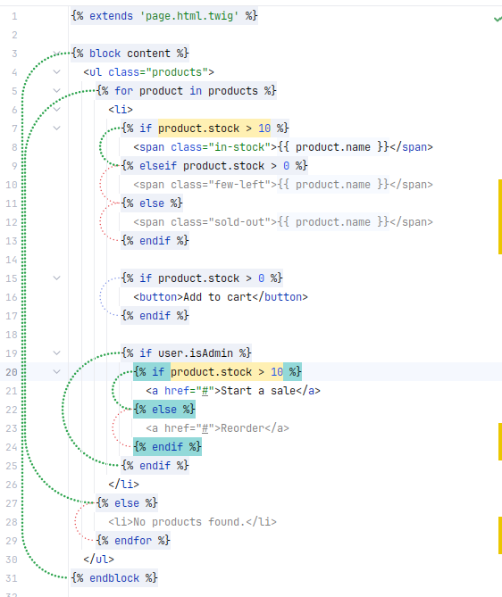

_Note: This is totally vibe-coded (Claude), and will continue to be. Use at your own risk._

# Twig Arcs: Matching Tag & Branch Highlighting

A PhpStorm plugin that shows the structure of Twig templates: which tags belong together, and which branch of an
`` / `` / `` the code under the caret is in. Made for long Twig templates, such as
Drupal and Symfony themes. PhpStorm's own tag tree highlighting only follows HTML; this is the Twig equivalent.



The caret is on the inner `` (line 20): its tags are highlighted, its `else` is excluded.
The first block has the same condition, so in the same loop iteration its `if` branch is certainly taken (green) and
its other branches are excluded (red). The template is [docs/showcase.html.twig](docs/showcase.html.twig).

## Features

- **Arcs for every block:** dotted curves connect the tags of each `if`, `for`, `block`, `macro`, `embed`, ...
  One arc per branch, so if/elseif/else reads like an inverted "3". The arcs use the indentation and the gutter,
  and nest.
- **Branch highlighting:** put the caret in a branch and it turns green; the other branches of the same block turn
  red and their content is greyed out.
- **Same condition elsewhere:** other `if` blocks with the same condition are decided too. Branches that cannot run
  together with the caret's line turn red; branches that are taken turn green, or alternate green/blue if it is
  unknown whether the code gets there (e.g. inside another, undecided `if`). The condition texts that decided it are
  highlighted. Respects `not`, `` and loop iterations.
- **Matching tag highlighting:** with the caret on a Twig tag, all tags of the same block are highlighted.
- **Tag backgrounds:** a pale background on `` tags sets Twig logic apart from markup; optional for `{{ }}`
  and `{# #}`.

Folding is not touched.

## Install

From JetBrains Marketplace: Settings → Plugins → Marketplace → search for "Twig Arcs".

Or from a zip: Settings → Plugins → ⚙ → *Install Plugin from Disk…* → choose the zip → restart.

Requires PhpStorm 2026.1 or newer (or another JetBrains IDE with the Twig plugin).

## Colors

Settings → Editor → Color Scheme → **Twig Arcs**:

- *Curves*: block without the caret (blue), branch with the caret (green), excluded branches (red),
  branch taken if reached (green, alternating with the blue).
- *Tags*: matching tags, the condition that decided another block.
- *Text in branches the caret is not in*: the greyed-out style.
- *Backgrounds*: ``, `{{ }}`, `{# #}`.

Clearing a color turns that effect off.

## Build

Requirements: Linux/macOS/Windows with internet access. A JDK 21 is downloaded automatically if none is found.

```sh
./gradlew buildPlugin    # → build/distributions/twigarcs-<version>.zip
./gradlew runIde         # try it in a separate sandbox PhpStorm
./gradlew verifyPlugin   # check compatibility against real IDE builds
```

The first run downloads Gradle and PhpStorm (~1 GB, needed to compile against), so it takes a while.

`prototype/index.html` is a standalone browser mockup that was used to design the look; open it in a browser.
It is not part of the plugin.

## License

MIT, see [LICENSE](LICENSE).
